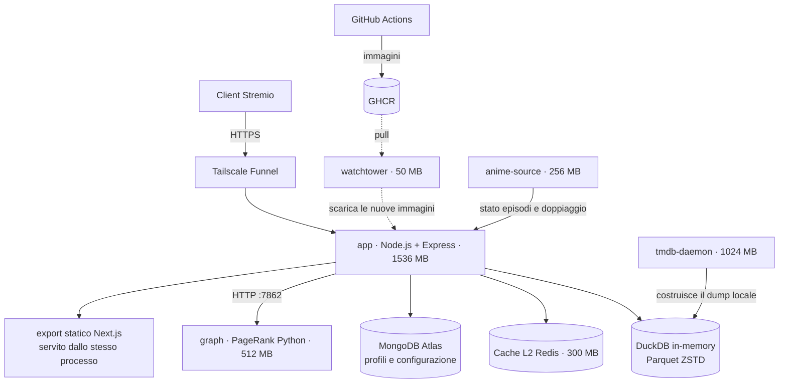

# YACA


Addon stateful per Stremio che risponde alle richieste di catalogo interrogando un dataset colonnare locale invece dell'endpoint di discovery di TMDB, e ordina i titoli con un servizio PageRank su cluster di film e serie correlati.

## Indice

- [Features](#features)
- [Il motore di raccomandazione](#il-motore-di-raccomandazione)
- [Come funziona](#come-funziona)
- [Documentazione](#documentazione)
- [Quickstart](#quickstart)
- [Configurazione](#configurazione)

## Features

- **Cataloghi da un dataset locale.** Filtri e paginazione sono SQL sul dump locale; l'endpoint di discovery remoto non è sul percorso della richiesta.
- **Righe hero con composizione spiegabile.** Quattro blocchi in ordine di priorità fisso — true blend, seed network, hidden gems, trakt filtered — ogni id assegnato una volta sola.
- **Una libreria che distingue fatti da deduzioni.** L'identità canonica decide se un titolo è film, serie o anime; i duplicati sono un bug, non una scelta di interfaccia.
- **Ricerca in linguaggio naturale.** Un router mappa una frase dalla barra di ricerca Stremio su filtri strutturati (opzionale, richiede una chiave Mistral).
- **Badge episodio anime e stato del doppiaggio italiano**, tenuti in memoria da un worker.
- **Sincronizzazione bidirezionale con Trakt** tramite device flow OAuth.

## Il motore di raccomandazione

Non esiste un bacino di utenti da cui imparare: questa è la storia di una persona su una istanza. Il collaborative filtering — la risposta usuale alla raccomandazione — richiede molti utenti che votino gli stessi titoli, e qui ce n'è esattamente uno. Tutto quello che segue nasce da questo vincolo: il segnale è il comportamento dell'utente, e la struttura deve venire dal contenuto.

### Il grafo

Un grafo eterogeneo su **76.497 titoli** con **14 tipi di legame**, ognuno con il proprio peso, fusi con reciprocal rank fusion (k = 15): co-visione, semantica delle keyword, trama, cast, regia, produzione, collezioni, co-occorrenza nelle liste e uno studente denso.

Lo studente è una **matrice 76.497 × 2.048 addestrata sul grafo stesso**; il suo SHA-256 è bloccato nella ricetta congelata. La build è riproducibile: le matrici sorgente sono congelate, ricetta e impronte vivono nel repository, e il grafo servito si ricostruisce da esse invece di essere dato per buono.

**La potatura è un vincolo di progetto.** Il grafo contiene 50.660.592 archi float32; senza potatura servirlo tocca i 627 MiB dentro un container da 512 MiB. Ogni titolo tiene i suoi 16 archi più forti: il 12% degli archi, 8,7× più economico, e la massa che resta sui compagni di saga sale dal 26,6% al 47,8%, contro lo 0,011% di un titolo qualunque. `runtime/bench.py` misura quel compromesso — memoria, tempo di caricamento, p50 e p95 — su tutte le configurazioni di potatura.

### La diffusione

La raccomandazione è un **PageRank personalizzato** che riparte da ciò che l'utente ha davvero segnalato: loved 3, liked 2, library 1, watched 1. Una serie pesa 1 + 2 × la frazione di episodi visti, così una serie da cento episodi vale due terzi di un film e non cento visioni; le ri-visioni di un film si fermano a 3; la watchlist è un desiderio, non un gusto, e arriva all'output solo tramite un ripescaggio limitato. La probabilità di riavvio è 0,60 (misurata, vedi sotto) e la camminata si ferma presto su una tolleranza L1 di 1e-5: il top 60 è identico a 20 iterazioni fisse, usando in media 10,4.

### Iperparametri, con il loro stato

`services/graph/parametri.py` tiene ogni numero in una tabella sola, e ognuno dichiara se è **misurato**, **dichiarato** come scelta di prodotto, o **inventato** — e quest'ultimo è la prima cosa da rivedere. Cinque, e cosa li ha decisi:

| Parametro | Valore | Cosa ha detto la misura |
|---|---|---|
| riavvio α | 0,60 | il valore a intuito, 0,15, rendeva peggio: 20,7× contro 29,3× |
| archi per titolo | top 16 | il 12% degli archi, 8,7× più economico, massa sulla saga 26,6% → 47,8% |
| tolleranza di convergenza | 1e-5 | top 60 identico a 20 iterazioni, 10,4 iterazioni in media |
| tetto del peso film | 3,0 | senza, a un utente di soli film le serie prendevano il 67% del seme; con il tetto, il 31% |
| peso serie | 1 + 2·frazione | evita che una serie lunga valga cento visioni |

### Esperimenti finiti in «no»

Tre idee ovvie sono state misurate e rimosse, e sono scritte perché l'intuito non le riporti dentro: la recenza usata come peso è indistinguibile dalle visioni da sole (18,12× contro 18,17×), il decadimento di rango è peggio di non fare niente (15,9× e 11,2× contro 18,2×), e i boost sui titoli recenti sono vuoti (17,85 → 17,9-18,1). Anche «quanti mondi si accendono» non è un segnale di gusto: una storia casuale della stessa lunghezza ne accende più di una vera (0,9× a ogni soglia), quindi quella soglia non esiste.

### Servizio

| Endpoint | p50 | p95 |
|---|---|---|
| `POST /raccomanda` | 1,0 ms | 17,4 ms |
| `POST /scaffali` | 1.525 ms | 1.698 ms (obiettivo ≤ 3 s per 8 scaffali) |

Il picco di RSS su 30 richieste sequenziali è 323,4 MiB contro un tetto di 512 MiB: il motore carica una matrice di vicini compatta (~65 MiB) e il singleton di runtime (~34 MiB). Il tetto è un vincolo di progetto, non un residuo.

Più in profondo: [docs/ENGINE.md](docs/ENGINE.md).

## Come funziona



Sei container, ognuno con un tetto di memoria dichiarato. L'app è l'unico componente esposto a internet, tramite un Funnel di Tailscale; il servizio del grafo, Redis, MongoDB e i worker sono raggiungibili solo dentro la rete compose.

| Componente | Responsabilità | Memoria |
|---|---|---|
| `app` | Superficie HTTP, logica dei cataloghi, query DuckDB, cache, frontend statico | 1536 MB |
| `graph` | PageRank sui cluster di titoli, servito su `:7862` | 512 MB |
| `redis` | Cache L2, `maxmemory 256mb`, `allkeys-lru`, persistenza disattivata | 300 MB |
| `tmdb-daemon` | Costruisce e aggiorna il dump Parquet locale | 1024 MB |
| `anime-source` | Badge episodio e stato del doppiaggio italiano | 256 MB |
| `watchtower` | Scarica le nuove immagini da GHCR e riavvia i container | 50 MB |

**Il percorso del catalogo.** Una richiesta viene risolta su due dataset locali: 117k titoli con titolo italiano e poster pronti (Tier 1) e 1.485.129 titoli dall'export TMDB letti tramite indice FTS5 (Tier 2). Quando entrambi contengono lo stesso id, vince il record locale. Se l'indice manca o è illeggibile, la risposta è esattamente quella di prima che il Tier 2 esistesse.

**Il percorso dell'ordinamento.** Un vettore di gusti (pesato per interazione: love 4×, like 3×, watch 2×) viene combinato con il servizio del grafo, che diffonde PageRank su cluster — "mondi" — di titoli correlati. Le righe hero sono riempite da quattro blocchi in ordine di priorità fisso, ogni id assegnato una volta sola, e l'intero gruppo viene messo in cache insieme. La chiave della cache si costruisce da contesto, modalità kids e selettori di tipo; metterci la versione della configurazione orfanerebbe l'intera cache a ogni salvataggio — misurate 18 chiavi orfane su 23, con la stessa combinazione utente/profilo/tipo ricostruita nove volte da 21 a 42 secondi.

### Decisioni principali

**I filtri dei cataloghi sono una query SQL su un dump locale.** Cambiare filtro non costa una chiamata esterna e funziona anche quando TMDB non risponde. L'alternativa — tradurre ogni richiesta in una chiamata di discovery remota — mette latenza e ordinamento del fornitore sul percorso della richiesta. Il prezzo è una pipeline dati che deve girare e restare fresca: `tmdb-daemon` esiste per questa scelta.

**Il grafo gira come processo Python separato.** Tiene 50,7 milioni di archi float32 e tocca 323,4 MiB mentre serve, contro un tetto di 512 MiB per container. In-process competererebbe con il percorso delle richieste per la memoria e si pagherebbe a ogni riavvio dell'app; dietro HTTP si carica una volta e il grafo si può ridistribuire senza toccare l'addon.

**Il taglio delle keyword è alfabetico e deterministico.** Prima campionava 30 keyword a caso tra i figli di un nodo, quindi lo stesso nodo restituiva un insieme diverso a ogni chiamata: osservato su 25 dei 469 nodi L2, il più ricco con 57 keyword. Pool diverso a ogni cache miss, ordinamento irriproducibile, cache che non colpiva mai. Un test di contratto protegge il taglio deterministico.

**La composizione dei poster vive fuori dal processo dell'app.** I badge venivano disegnati in-process con `sharp` e `text-to-svg`, dietro una cache su disco. La composizione ora appartiene a un servizio esterno; YACA rende `/erdb-poster/:file` al primo miss, accoda l'evento se il servizio è giù, e tiene `/images/poster/...` come 302 per i client che conservano URL vecchi. `BadgeDiskCache`, `sharp` e `text-to-svg` non ci sono più, lockfile compresi.

### Misure

Correzioni misurate in produzione (ottobre 2026):

| Correzione | Prima | Dopo |
|---|---|---|
| Titoli mostrati con caratteri CJK | 716 serie su 3.177, 1.845 film su 4.351 | serie visibili 481 → 1, film 32 → 0, 757 titoli sanati |
| Quota anime in pagina 1 dell'hero per un profilo con DNA anime | 15 % | 100 % |
| Merge e interleave fra cataloghi | usati da 0 cataloghi su 73 | rimossi, tenuto il percorso di modifica |

La campagna di pulizia che è seguita ha rimosso percorsi morti, definizioni duplicate e due cache scritte a mano (sostituite dalla `LRUCache` già presente nel repository): 830 righe in meno dal codice, e `isItemAnime` da 4 definizioni a 1.

### Stato e limiti noti

| Cosa | Impatto | Stato |
|---|---|---|
| Un fallback può finire in cache come raccomandazione | profilo freddo: «scelti per te» uguale a «film popolari» per 7 giorni, visibile solo nei log (`fallbackUsed=true`) | aperto, correzione nota |
| La suite di test non gira in CI | i tre workflow costruiscono e pubblicano immagini; una regressione può passare inosservata | aperto |
| `heroMovieDateRegression` fallisce in suite completa, passa isolato | un rosso di cui non fidarsi | accettato, dipendenza dall'ordine |
| Il percorso dei cataloghi non ha un benchmark | nessuna cifra riproducibile da dichiarare, quindi nessuna ne viene dichiarata | accettato |
| L'uso non è strumentato | nessun dato su profili, richieste o uptime | accettato |
| Assunzioni da singolo utente | i profili sono configurazione, non account; nessun isolamento multi-tenant | accettato per progetto |

## Documentazione

Documentazione di prodotto, tenuta allineata al codice (la convenzione è che il codice è la verità e i documenti lo seguono):

- [Grafo delle raccomandazioni](docs/RECOMMENDATION_GRAPH.md) — il servizio PageRank, il suo contratto e le misure qui sopra
- [Architettura DuckDB](docs/DUCKDB_ARCHITECTURE.md) — il dataset colonnare in memoria
- [Algoritmi e scoring](docs/ALGORITHMS.md) — vettore di gusti, rating bayesiano, contratti hero, trappole note
- [Logica dei cataloghi](docs/CATALOG_LOGIC.md) — ciclo di vita delle richieste, cache a due livelli, ricerca Tier 1 / Tier 2
- [Internals Stremio](docs/STREMIO_INTERNALS.md) — manifest, profili, mapping anime
- [Modulo libreria](docs/LIBRARY_MODULE.md) — fatti contro deduzioni, identità canonica
- [Motore AI](docs/AI_ENGINE.md) — routing della ricerca in linguaggio naturale
- [Frontend](docs/FRONTEND.md) — l'export statico e il modello di sessione
- [Integrazioni](docs/INTEGRATIONS.md) — device flow di Trakt
- [Testing e utilities](docs/TESTING_UTILITIES.md) — suite e script operativi
- [Deploy su home server](docs/DEPLOYMENT_HOME_SERVER.md) — Docker Compose, Tailscale, Watchtower
- [Changelog](docs/CHANGELOG.md) — modifiche recenti con le misure che le sostengono

## Quickstart

Requisiti: Node.js 20+, Redis e MongoDB (Atlas va bene). Il servizio del grafo è opzionale: senza di esso l'ordinamento ricade sul solo scoring.

```bash
npm ci
cd frontend && npm ci && cd ..
npm run build        # compila l'export Next.js
npm start            # node --expose-gc index.js, in ascolto su :7860
```

Per lo stack completo, incluso il servizio del grafo, Redis, il costruttore del dump e gli aggiornamenti automatici:

```bash
docker compose up -d
```

Test:

```bash
npm test          # Jest: 199 suite, 1.986 test, ~111 s
pytest services   # servizi Python
```

## Configurazione

| Variabile | Obbligatoria | Descrizione |
|---|---|---|
| `MONGODB_URI` | **Sì** | Stringa di connessione a MongoDB Atlas per profili e account. |
| `TMDB_API_KEY` | **Sì** | API key globale TMDB per i metadati estesi. |
| `HOST_URL` | **Sì** | URL pubblico del server, usato per poster, badge e manifest Stremio. |
| `REDIS_URL` | No | Server della cache L2 (default `redis://127.0.0.1:6379`, `redis://redis:6379` in compose). |
| `MISTRAL_API_KEY` | No | Abilita la ricerca in linguaggio naturale. |
| `JWT_SECRET` | No | Chiave di firma dei token di sessione (fallback casuale a ogni avvio se assente). |
| `PORT` | No | Porta HTTP del backend (default `7860`). |
| `GRAPH_SERVICE_URL` | No | URL del servizio di raccomandazione (default `http://graph:7862` nella rete compose). |
| `GRAPH_TAG` | No | Tag dell'immagine Docker `yaca-graph` (default `latest`). |
| `TRAKT_CLIENT_ID` | No | Client id Trakt.tv per la sincronizzazione di libreria e cronologia. |
| `TRAKT_CLIENT_SECRET` | No | Client secret Trakt.tv per il flusso OAuth. |
| `CORS_ALLOWED_ORIGINS` | No | Origini consentite per le API pubbliche (default `*`). |
