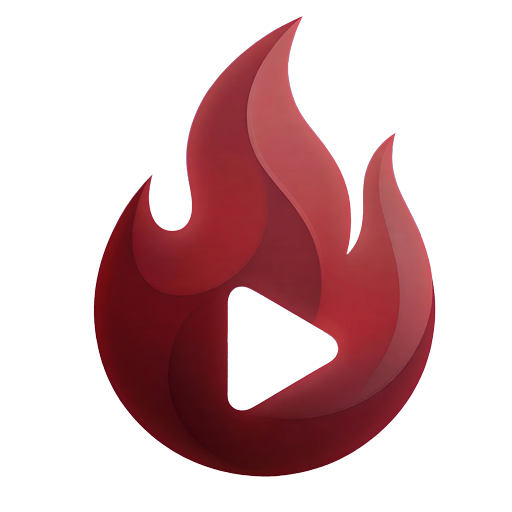
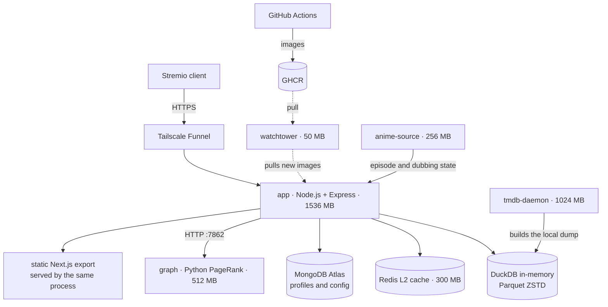

# YACA



A stateful Stremio addon that answers catalog requests from a local columnar dataset instead of calling TMDB's discovery endpoint, and ranks titles with a PageRank service over clusters of related films and series.

## Table of contents

- [Features](#features)
- [How it works](#how-it-works)
- [Documentation](#documentation)
- [Quickstart](#quickstart)
- [Configuration](#configuration)

## Features

- **Catalogs from a local dataset.** Filter and pagination are SQL over the local dump; the remote discovery endpoint is not on the request path.
- **Hero rows with explainable composition.** Four blocks in fixed priority order — true blend, seed network, hidden gems, Trakt-filtered — each id assigned once.
- **A library that distinguishes facts from inferences.** Canonical identity decides whether a title is a film, a series or an anime; duplicates are a bug, not a UI choice.
- **Natural-language search.** A router maps a sentence from the Stremio search bar onto structured filters (optional, needs a Mistral key).
- **Anime episode badges and Italian dubbing state**, kept in memory by a worker.
- **Two-way Trakt sync** through the OAuth device flow.

## How it works



Six containers, each with a declared memory ceiling. The app is the only component exposed to the internet, through a Tailscale Funnel; the graph service, Redis, MongoDB and the workers are reachable only inside the compose network.

| Component | Responsibility | Memory |
|---|---|---|
| `app` | HTTP surface, catalog logic, DuckDB queries, cache, static frontend | 1536 MB |
| `graph` | PageRank over title clusters, served on `:7862` | 512 MB |
| `redis` | L2 cache, `maxmemory 256mb`, `allkeys-lru`, persistence off | 300 MB |
| `tmdb-daemon` | Builds and refreshes the local Parquet dump | 1024 MB |
| `anime-source` | Episode badges and Italian dubbing state | 256 MB |
| `watchtower` | Pulls new images from GHCR and restarts containers | 50 MB |

**The catalog path.** A request is resolved against two local datasets: 117k titles with an Italian title and a ready poster (Tier 1), and 1,485,129 titles from the TMDB export read through an FTS5 index (Tier 2). When both contain the same id, the local record wins. If the index is missing or unreadable, the response is exactly what it was before Tier 2 existed.

**The ranking path.** A taste vector (weighted by interaction: love 4×, like 3×, watch 2×) is combined with the graph service, which diffuses PageRank over clusters — "worlds" — of related titles. Hero rows are filled by four blocks in a fixed priority order, each id assigned once, and the whole group cached together. The cache key is built from context, kids mode and type selectors; putting the configuration version in it would orphan the entire cache on every save — measured at 18 orphan keys out of 23, with the same user/profile/type combination rebuilt nine times at 21 to 42 seconds each.

### Main decisions

**Catalog filters are a SQL query over a local dump.** A filter change costs no external call and works when TMDB does not answer. The alternative — translating each request into a remote discovery call — puts the provider's latency and ordering on the request path. The cost is a data pipeline that must run and stay fresh: `tmdb-daemon` exists because of this choice.

**The graph runs as a separate Python process.** Loading the artifact takes 2.05 s and 128 MB resident. In-process it would be paid at every app restart and would compete with the request path for memory. Behind HTTP it is loaded once and sits idle at 128 MB, and the graph can be redeployed without touching the addon.

**The keyword cut is alphabetical and deterministic.** It used to sample 30 keywords at random from a node's children, so the same node returned a different set on every call: observed on 25 of the 469 L2 nodes, the richest having 57 keywords. Different pool on every cache miss, unreproducible ranking, cache that never hit. A contract test protects the deterministic cut.

**Poster composition lives outside the app process.** Badges used to be drawn in-process with `sharp` and `text-to-svg`, behind a disk cache. The composition now belongs to an external service; YACA renders `/erdb-poster/:file` on first miss, queues the event if the service is down, and keeps `/images/poster/...` as a 302 for clients that still hold old URLs. `BadgeDiskCache`, `sharp` and `text-to-svg` are gone, lockfiles included.

### Measurements

Graph service — benchmark on a real sample: 100 seeds of Trakt history, 4 lists, cap 60.

| Metric | Value | Note |
|---|---|---|
| Process start, artifact loading | 2.05 s | 66,259 titles and 3,497 clusters from `.npz` |
| `GET /health` | 0.25 ms | contract: under 1 ms |
| `POST /raccomanda`, cold | 95.44 ms | first call after start |
| `POST /raccomanda`, warm | 92.39 ms | mean of 10 iterations, min 86.62 ms |
| Resident memory | 128.4 MB | container limit 512 MB |
| Artifact volume on host | 138 MB | against 666 MB with local leftovers |

Corrections measured in production (October 2026):

| Fix | Before | After |
|---|---|---|
| Titles shown with CJK characters | 716 of 3,177 series, 1,845 of 4,351 films | visible series 481 → 1, films 32 → 0, 757 titles backfilled |
| Anime share in hero page 1 for a profile with anime DNA | 15 % | 100 % |
| Merge and interleave between catalogs | used by 0 of 73 catalogs | removed, the edit path kept |

The cleanup campaign that followed removed dead paths, duplicated definitions and two hand-written caches (replaced by the `LRUCache` already in the repository): 830 lines out of the codebase, and `isItemAnime` from 4 definitions to 1.

### Status and known limits

| Item | Impact | Status |
|---|---|---|
| A fallback can be cached as if it were a recommendation | cold profile: "picked for you" equals "popular films" for 7 days, visible only in the logs (`fallbackUsed=true`) | open, fix known |
| The test suite does not run in CI | the three workflows build and publish images; a regression can merge unnoticed | open |
| `heroMovieDateRegression` fails in the full run, passes alone | a red that is not trustworthy | accepted, ordering dependency |
| The catalog path has no benchmark | no reproducible figure to claim, so none is claimed | accepted |
| Usage is not instrumented | no data on profiles, requests or uptime | accepted |
| Single-user assumptions | profiles are configuration, not accounts; no multi-tenant isolation | accepted by design |

## Documentation

Product documentation, kept aligned with the code (the convention is that code is the truth and documents follow it):

- [Recommendation graph](docs/RECOMMENDATION_GRAPH.md) — the PageRank service, its contract and the measurements above
- [DuckDB architecture](docs/DUCKDB_ARCHITECTURE.md) — the in-memory columnar dataset
- [Algorithms and scoring](docs/ALGORITHMS.md) — taste vector, Bayesian rating, hero contracts, known traps
- [Catalog logic](docs/CATALOG_LOGIC.md) — request lifecycle, two-level cache, Tier 1 / Tier 2 search
- [Stremio internals](docs/STREMIO_INTERNALS.md) — manifests, profiles, anime mapping
- [Library module](docs/LIBRARY_MODULE.md) — facts versus inferences, canonical identity
- [AI engine](docs/AI_ENGINE.md) — natural-language search routing
- [Frontend](docs/FRONTEND.md) — the static export and session model
- [Integrations](docs/INTEGRATIONS.md) — Trakt device flow
- [Testing and utilities](docs/TESTING_UTILITIES.md) — suites and operational scripts
- [Deployment on a home server](docs/DEPLOYMENT_HOME_SERVER.md) — Docker Compose, Tailscale, Watchtower
- [Changelog](docs/CHANGELOG.md) — recent changes with the measurements behind them

## Quickstart

Requirements: Node.js 20+, Redis, and MongoDB (Atlas works). The graph service is optional — without it, ranking falls back to scoring only.

```bash
npm ci
cd frontend && npm ci && cd ..
npm run build        # compiles the Next.js export
npm start            # node --expose-gc index.js, listening on :7860
```

For the full stack, including the graph service, Redis, the dump builder and auto-updates:

```bash
docker compose up -d
```

Tests:

```bash
npm test          # Jest: 199 suites, 1,986 tests, ~111 s
pytest services   # Python services
```

## Configuration

| Variable | Required | Description |
|---|---|---|
| `MONGODB_URI` | **Yes** | MongoDB Atlas connection string for profiles and accounts. |
| `TMDB_API_KEY` | **Yes** | Global TMDB API key for extended metadata. |
| `HOST_URL` | **Yes** | Public URL of the server, used for posters, badges and the Stremio manifest. |
| `REDIS_URL` | No | L2 cache server (default `redis://127.0.0.1:6379`, `redis://redis:6379` in compose). |
| `MISTRAL_API_KEY` | No | Enables natural-language search. |
| `JWT_SECRET` | No | Session token signing key (random fallback at each start when absent). |
| `PORT` | No | Backend HTTP port (default `7860`). |
| `GRAPH_SERVICE_URL` | No | Recommendation service URL (default `http://graph:7862` in the compose network). |
| `GRAPH_TAG` | No | Docker image tag for `yaca-graph` (default `latest`). |
| `TRAKT_CLIENT_ID` | No | Trakt.tv client id for library and history sync. |
| `TRAKT_CLIENT_SECRET` | No | Trakt.tv client secret for the OAuth flow. |
| `CORS_ALLOWED_ORIGINS` | No | Allowed origins for public APIs (default `*`). |
